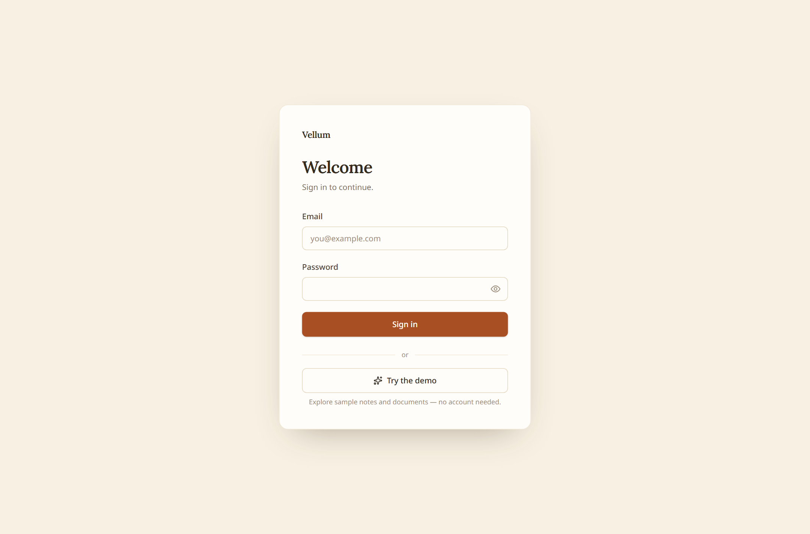
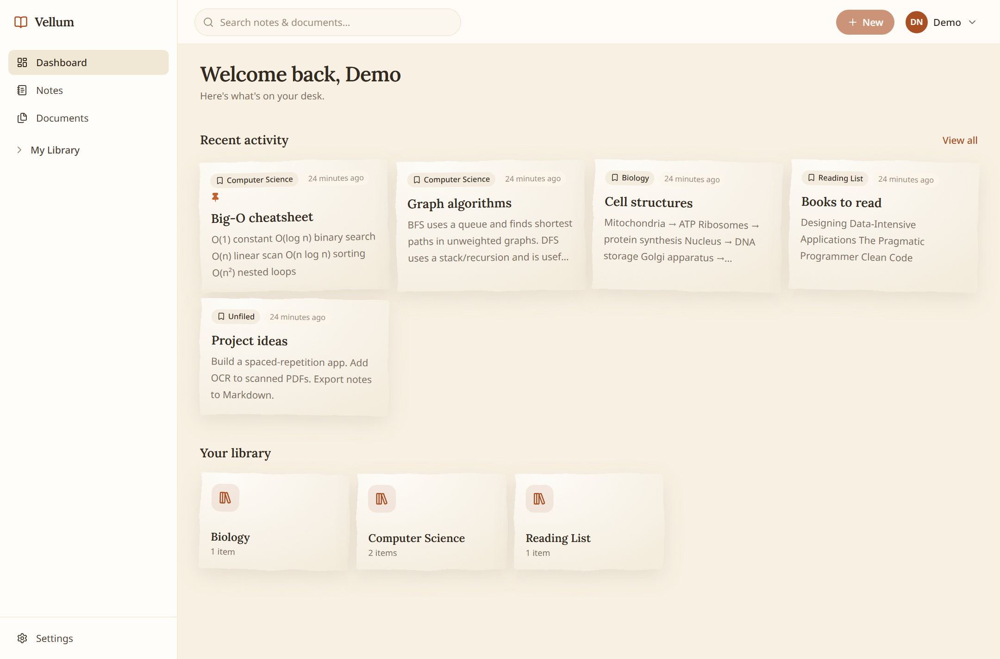
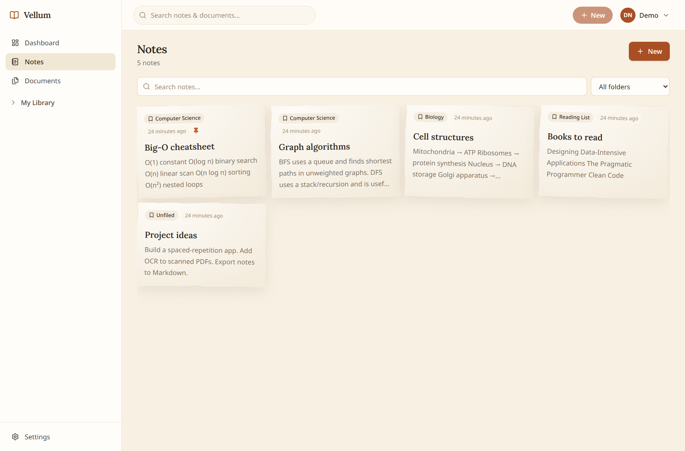
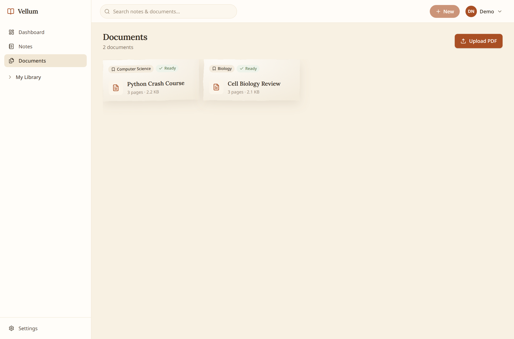
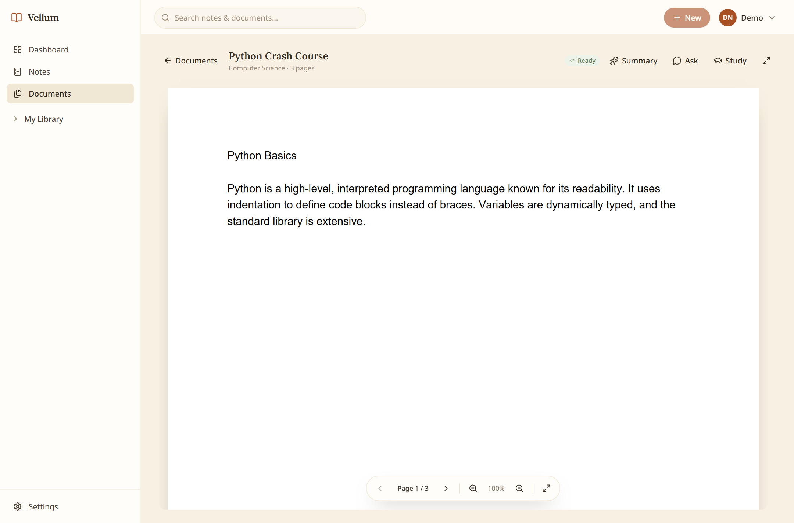
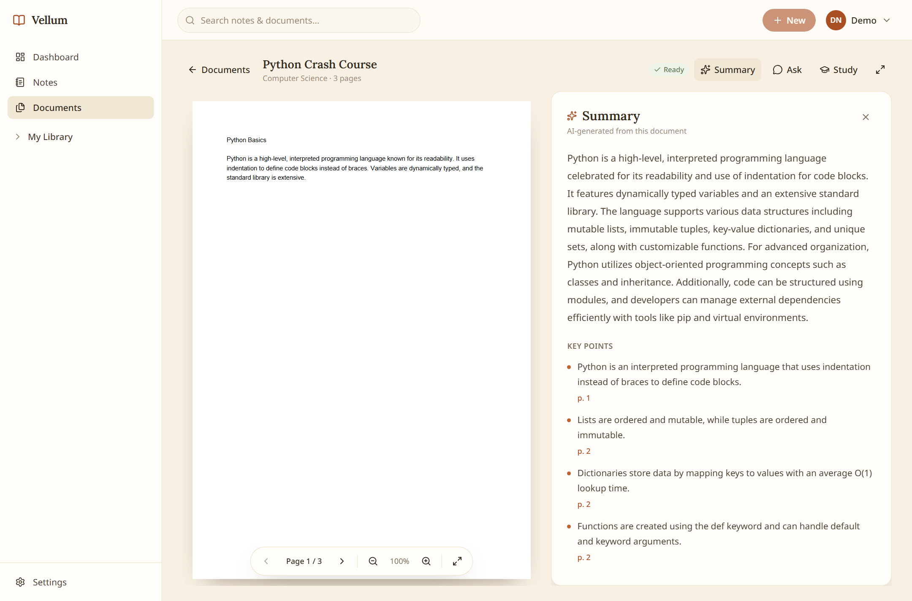
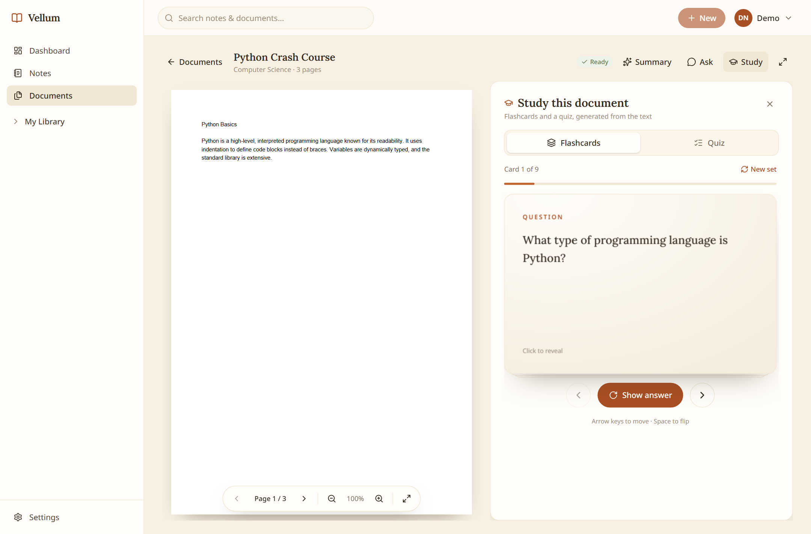
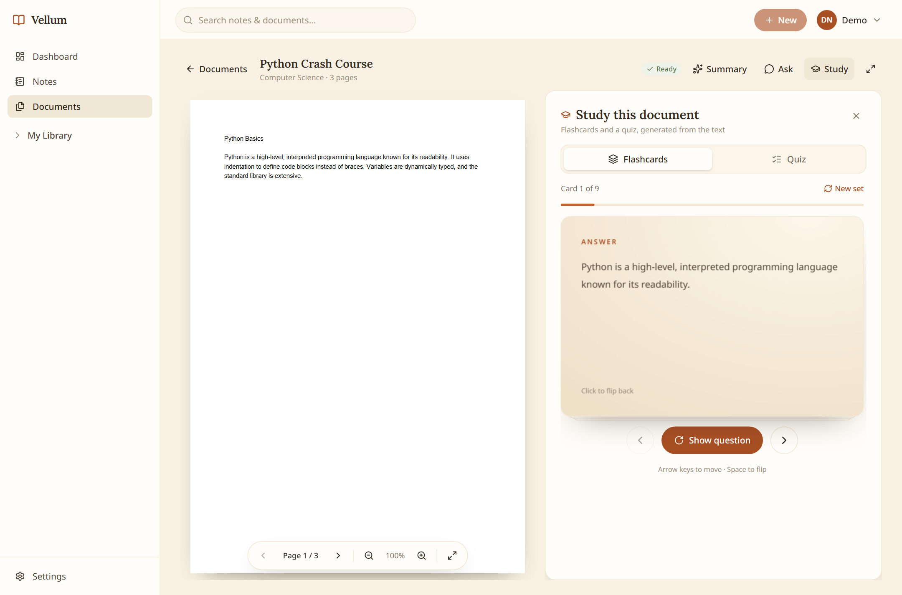
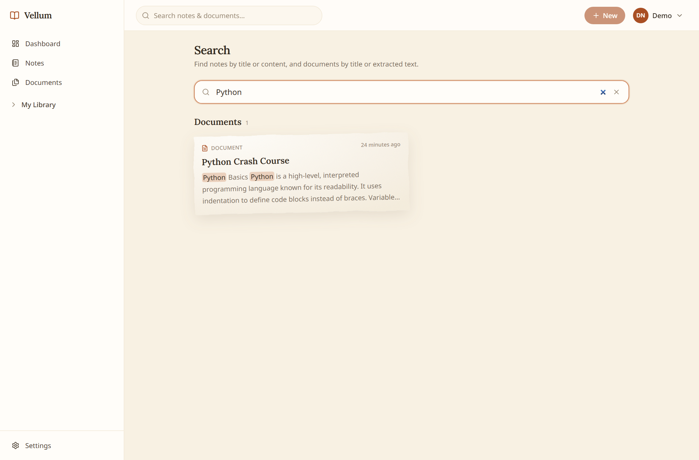

# Vellum — AI Notes & Document Manager

A production-quality portfolio project: an AI-powered notes and document management
web app for students and professionals. Store notes, organize them into folders,
upload and view PDFs, and use AI to summarize documents, answer questions about them,
and turn them into flashcards and quizzes.

## Stack

| Layer      | Technology |
|------------|------------|
| Frontend   | React, TypeScript, Vite, Tailwind CSS, React Router, TanStack Query |
| Backend    | FastAPI, Python, SQLAlchemy (async), Alembic, Pydantic v2 |
| Database   | PostgreSQL (via Supabase) |
| Auth/Files | Supabase Auth, Supabase Storage |
| AI         | Gemini (via OpenAI-compatible endpoint) behind an `AIService` abstraction |

## Screenshots

| One-click demo | Dashboard |
| --- | --- |
|  |  |

| Notes | Documents |
| --- | --- |
|  |  |

| PDF reader | AI summary with page citations |
| --- | --- |
|  |  |

| Flashcards | Flashcard answer (3D flip) |
| --- | --- |
|  |  |

**Global search** — notes and documents, with highlighted snippets:



## Repository layout

```
vellum/
├── backend/    # FastAPI service
├── frontend/   # React SPA
└── docs/       # architecture notes (optional)
```

## Progress & plan

The architecture, decisions, and a running progress log live in
**[`docs/PROGRESS.md`](docs/PROGRESS.md)**. Read it first — it is the project's
single source of truth and is updated at the end of every work session.

## Getting started

### Backend

```powershell
cd backend
python -m venv .venv
.\.venv\Scripts\Activate.ps1
pip install -e ".[dev]"
copy .env.example .env      # then fill in values
uvicorn app.main:app --reload
```

### Frontend

```powershell
cd frontend
npm install
copy .env.example .env      # then fill in values
npm run dev
```

See `docs/` and the plan file for architecture details.

## Development rules

- One feature/level at a time; keep changes modular.
- Never commit secrets. Use `.env` files locally; `.env.example` documents the keys.
- Never expose API keys in frontend code.
- Handle errors explicitly; keep frontend/backend boundaries clear.
